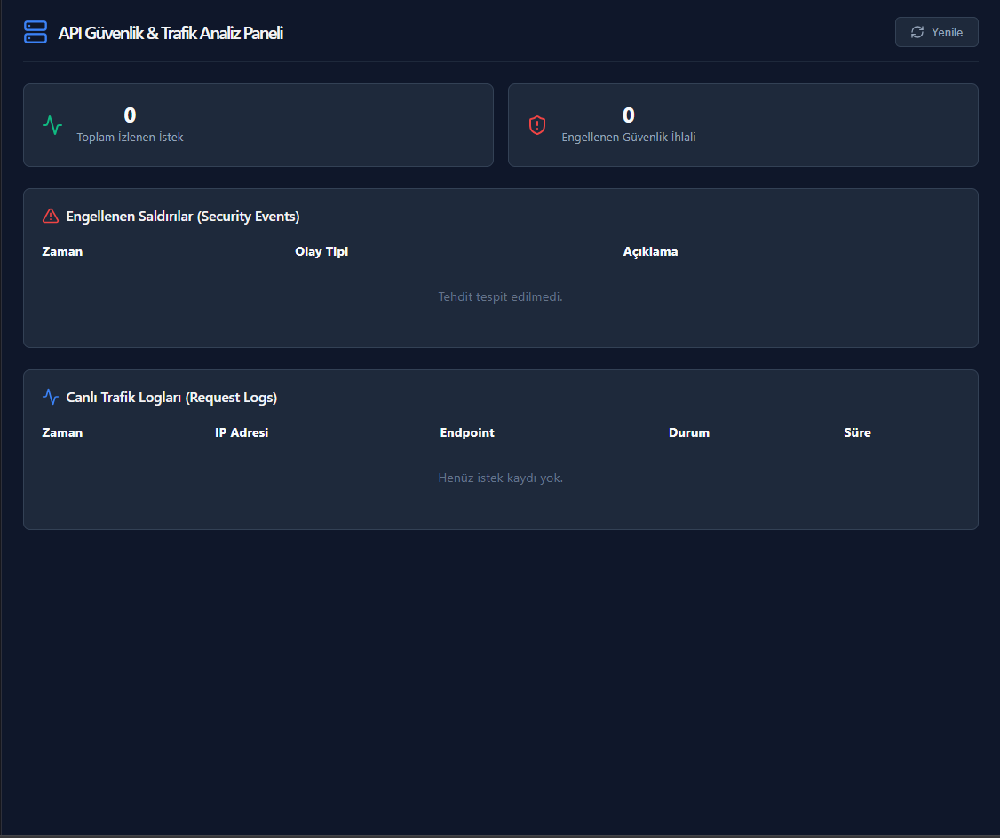
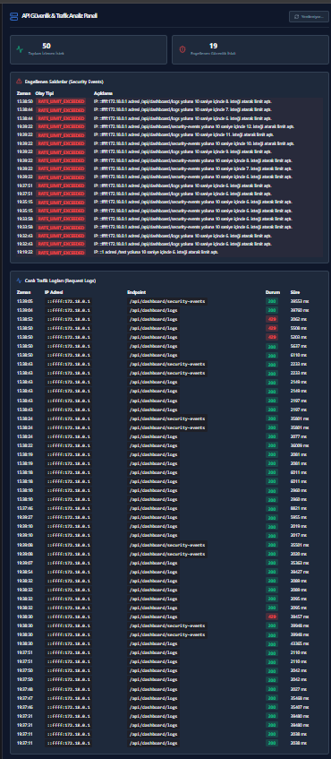

Markdown
# 🛡️ API Güvenlik ve Trafik Analiz Platformu


.NET 10 Web API, Supabase (PostgreSQL), React (Vite) ve Docker kullanılarak geliştirilmiş; API trafiğini anlık izleyen, katmanlı mimariye (Clean Architecture) sahip ve hız sınırlandırma (Rate Limiting) mekanizması içeren kurumsal güvenlik platformu.

---

## 📸 Canlı Ekran Görüntüleri

| Başlangıç Durumu (Boş Panel) | Canlı Trafik & Rate Limit Testi |
| :---: | :---: |
|  |  |

---

## 📐 Mimari ve Klasör Yapısı

Proje, katmanlı mimari ilkelerine uygun şekilde **Backend** ve **Frontend** olarak fiziksel dizin seviyesinde tamamen ayrıştırılmıştır:

```text
API_Güvenlik_Trafik_Analiz_Platformu/
├── backend/
│   ├── ApiSecurityPlatform/   # ASP.NET Core 10.0 Web API (Controllers, Middlewares)
│   ├── Application/           # DTOs, Interfaces, Business Logic
│   ├── Domain/                # Entities (RequestLog, SecurityEvent)
│   ├── Infrastructure/        # DbContext, Supabase PostgreSQL Integration
│   └── Dockerfile             # Multi-stage .NET 10 Build & Runtime
├── frontend/
│   ├── src/                   # React + Vite + Lucide React Dashboard
│   ├── Dockerfile             # Node.js Build & Nginx Web Server
│   └── package.json
├── docker-compose.yml         # Konteyner Orkestrasyonu
└── README.md
✨ Öne Çıkan Özellikler
Trafik İzleme (Traffic Logging Middleware): Gelen her HTTP isteğini (IP adresi, Endpoint, HTTP Yöntemi, Durum Kodu, Yanıt Süresi) yakalar ve Supabase veritabanındaki RequestLogs tablosuna kaydeder.

Hız Sınırlandırma (Rate Limiting Middleware): Belirli zaman aralıklarında belirlenen limitleri aşan istemcileri anında engeller (HTTP 429 Too Many Requests) ve güvenlik ihlalini SecurityEvents tablosuna aktarır.

Konteynerizasyon (Docker & Docker Compose): .NET 10 SDK (Backend) ve Node/Nginx (Frontend) multi-stage imajları ile ortam bağımsız tek komutla ayağa kalkar.

Canlı Dashboard Paneli: React ve Axios ile veritabanından 5 saniyede bir otomatik verileri çekerek canlı trafik ve engellenen saldırı istatistiklerini sunar.

Bulut Veritabanı Entegrasyonu: Supabase Transaction Pooler (Port 6543) bağlantısı üzerinden yüksek erişilebilirlik ve Retry/Timeout hata tolerans ayarları sunar.

🛠️ Teknolojiler
Backend: C# / .NET 10 Web API, Entity Framework Core 9.0

Frontend: React 18, Vite, Tailwind CSS, Lucide React

Veritabanı: PostgreSQL (Supabase Cloud Service)

Konteyner & Sunucu: Docker, Docker Compose, Nginx (Alpine)

🚀 Kurulum ve Çalıştırma
Ön Gereksinimler
Git

Docker Desktop (WSL 2 / Virtual Machine Platform aktif)

1. Repoyu Klonlayın
Bash
git clone [https://github.com/KULLANICI_ADI/API_Güvenlik_Trafik_Analiz_Platformu.git](https://github.com/KULLANICI_ADI/API_Güvenlik_Trafik_Analiz_Platformu.git)
cd API_Güvenlik_Trafik_Analiz_Platformu
2. Docker Compose ile Başlatın
Bash
docker compose up --build -d
3. Erişilebilirlik Adresleri
🎨 Frontend Dashboard: http://localhost:5173

⚡ Backend API Endpoint: http://localhost:5253/api/dashboard/logs

📊 Test Raporları ve Performans Analizi
Sistemin dayanıklılığı, loglama hassasiyeti ve güvenlik sınırları Docker ortamında gerçek istekler simüle edilerek doğrulanmıştır.

1. Normal Trafik ve Endpoint Doğrulama Testi (HTTP 200 OK)
Senaryo: Frontend paneli ve harici istemcilerin /api/dashboard/logs endpoint'ine yaptığı rutin GET istekleri.

Sonuç: İstekler ortalama 1.9ms - 2.1ms yanıt süresi (durationMs) ile işlenmiş, istemci IP adresleri Docker bridge ağ geçidi (::ffff:172.18.0.1) üzerinden tespit edilerek veritabanına statusCode: 200 olarak kaydedilmiştir.

JSON
{
  "id": 165,
  "endpoint": "/api/dashboard/logs",
  "clientIp": "::ffff:172.18.0.1",
  "statusCode": 200,
  "durationMs": 2012,
  "timestamp": "2026-11-09T16:32:05.677274Z"
}
2. Rate Limiting ve İhlal Engelleme Testi (HTTP 429)
Senaryo: İstemci tarafından 1 saniye içerisinde 15 adet eşzamanlı istek atılarak kural aşımı simüle edilmiştir.

PowerShell
1..15 | ForEach-Object { Invoke-RestMethod -Uri "http://localhost:5253/api/dashboard/logs" }
Sonuç: Belirlenen eşik değeri aşıldığında RateLimitingMiddleware devreye girmiş, istemciye HTTP 429 yanıtı dönülmüş ve ihlal detayları Engellenen Saldırılar sekmesine anında yansıtılmıştır.

3. Bulunamayan Endpoint ve Hata Yakalama Testi (HTTP 404)
Senaryo: Tanımsız kök dizine (/) yapılan isteklerin loglanması.

Sonuç: .NET 10 tarafında route karşılığı olmamasına rağmen TrafficLoggingMiddleware isteği başarıyla yakalamış ve 0ms gecikme ile statusCode: 404 kaydı oluşturmuştur.

JSON
{
  "id": 153,
  "endpoint": "/",
  "clientIp": "::ffff:172.18.0.1",
  "statusCode": 404,
  "durationMs": 0,
  "timestamp": "2026-11-09T16:30:44.306846Z"
}
4. Konteynerizasyon & İzolasyon Testi
Sonuç: Backend (api_security_backend) ve Frontend (api_security_frontend) konteynerleri isolated Docker network (api_gvenlik_trafik_analiz_platformu_default) üzerinden kesintisiz haberleşmektedir. .NET 10 SDK multi-stage derleme süresi ~60 saniye olarak ölçülmüştür.

📜 Lisans
Bu proje eğitim ve geliştirme amaçlı açık kaynak olarak lisanslanmıştır.